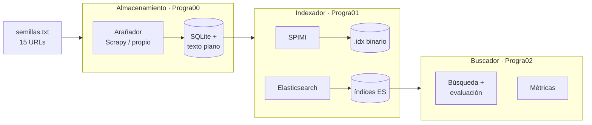

# Encuadre

Sistema de recuperación de información textual sobre el dominio audiovisual:
guiones de cine, series, anime y crítica especializada. Recolecta documentos de
la web, los normaliza, construye un índice invertido binario y permite
consultarlos por similitud coseno.

Desarrollado para el curso **IC-8060, Recuperación de Información Textual** del
Tecnológico de Costa Rica.

## Componentes

El sistema está separado en tres piezas independientes que se comunican por el
almacenamiento compartido y el archivo de índice:

| Componente | Carpeta | Responsabilidad | Estado |
|---|---|---|---|
| **Almacenamiento** | `Progra00/` | Cosecha web, extracción de texto limpio, deduplicación y persistencia | Completo |
| **Indexador** | `Progra01/` | Índice invertido binario `.idx`, ponderación TF/IDF y ranking | Completo |
| **Buscador** | `Progra02/` | Interfaz de búsqueda, evaluación de relevancia y métricas | Completo; faltan los juicios de personas |



## Almacenamiento

Recolecta el corpus desde 15 semillas del dominio audiovisual y guarda cada
documento como texto plano junto con sus metadatos en SQLite. Incluye dos
implementaciones de la misma necesidad de información, para poder compararlas:

| Implementación | Ruta | Dependencias |
|---|---|---|
| Con bibliotecas | `Progra00/arañador/` | Scrapy, Trafilatura, matplotlib |
| Propia | `Progra00/propio/` | Solo biblioteca estándar de Python |

Ambas respetan `robots.txt`, aplican cortesía por host, deduplican por SHA-256
de URL y de contenido, controlan la frescura a 30 días y comparten la tabla
`frontera`, de modo que se puede alternar entre las dos sin volver a descargar
lo ya guardado.

```bash
cd "Progra00/arañador"
cp .env.example .env
uv sync
uv run arañador              # cosecha; Ctrl+C para detener, repetir para reanudar
uv run arañador informe      # estadísticas + curva de Zipf
```

```bash
cd Progra00/propio
cp .env.example .env
uv sync
uv run propio verificar      # valida semillas, hosts y base
uv run propio                # cosecha con hilos
```

El almacenamiento resultante es único y compartido por todo el sistema:

```text
Progra00/almacenamiento/
├── metadatos_araña.db          # documentos, frontera y bitácora de recorrido
└── repositorio/<dominio>/documentos/<hash[:2]>/<hash>.txt
```

Los informes estadísticos y la curva de Zipf se escriben en
`Progra00/resultados/`. Detalles de políticas y discusión comparativa en
[`Progra00/README.md`](Progra00/README.md),
[`Progra00/arañador/README.md`](Progra00/arañador/README.md) y
[`Progra00/propio/README.md`](Progra00/propio/README.md).

## Indexador

El motor **Encuadre** construye un índice invertido en formato binario `.idx`
escrito a mano con `struct.pack` y `struct.unpack` en Little-Endian: cabecera de
64 bytes con la firma `ENCUADRE`, construcción por bloques con SPIMI,
ponderación TF/IDF y ranking por similitud coseno.

Tres políticas de normalización configurables en `Progra01/propio/configuraciones/`,
compartidas con `Progra01/elasticsearch/`:

| Política | Normalización |
|---|---|
| `minimo.conf` | Minúsculas y puntuación, sin stopwords ni stemming |
| `estandar.conf` | Stopwords ES+EN y stemming Snowball |
| `avanzado.conf` | Además plegado de tildes, números, fechas y expansión por sinónimos |

```bash
cd Progra01/propio
uv sync

uv run indexador indexar --config configuraciones/estandar.conf --limite 1000
uv run indexador inspeccionar salida/indice_estandar.idx --termino "film"
uv run indexador buscar salida/indice_estandar.idx "film director" --top 5
uv run indexador benchmark --limite 10000
bash scripts/regenerar_todo.sh 10000   # índices, estadísticas, comparación y PDF
```

`benchmark` compara las tres políticas (vocabulario, postings, tamaño, tiempo y
memoria pico) y escribe `propio/salida/benchmark_indices.json`.

La segunda implementación vive en `Progra01/elasticsearch/` (Node + Elasticsearch
8.15.3 con el plugin `analysis-icu`) y lee las mismas políticas y los mismos
recursos que la propia. Levanta el servicio con
`docker compose up -d --build` dentro de esa carpeta.

> [!NOTE]
> El indexador lee directamente de `Progra00/almacenamiento/`, así que la ruta
> `base_datos` de los `.conf` asume que ambas carpetas están al mismo nivel.

## Buscador

Interfaz web de consulta sobre los índices de Elasticsearch, con un modo
independiente para que la persona usuaria marque resultados relevantes
(0/1/2) y una página de métricas (P@k, MAP, nDCG@k, MRR, recall y κ de Cohen).
La especificación está en `Progra02/Instrucciones.md` y el informe en
`Progra02/documento/Progra02.pdf`.

```bash
cd Progra02
npm install
npm start            # http://localhost:3000, /evaluar y /metricas
```

Requiere Elasticsearch corriendo con los índices de `Progra01/elasticsearch/`.
El buscador enlaza a la página original de cada documento, no al `.txt`.

## Requisitos

- Python 3.12+ para el almacenamiento, Python 3.13+ para el indexador
- [`uv`](https://docs.astral.sh/uv/) para gestionar entornos y dependencias

## Pruebas

Cada componente se prueba por separado:

```bash
cd Progra01/propio && uv run pytest && uv run ruff check src scripts tests
cd Progra01/elasticsearch && node --test
cd Progra02 && npm test
cd "Progra00/arañador" && uv run pytest
cd Progra00/propio && uv run pytest
```

## Datos y artefactos

Los corpus descargados, bases de datos, bitácoras, resultados e índices **no se
versionan**; las reglas comunes están en `.gitignore`. El paquete de entrega se
genera con el script de abajo.

## Entrega

```bash
bash scripts/empaquetar_entrega.sh
```

Genera `entrega_rit.tar.gz` en la raíz. Incluye el repositorio Git completo
(con `.git`), los tres proyectos con sus fuentes LaTeX, PDFs, tablas, datos y
enunciados, los tres índices `Progra01/propio/salida/indice_*.idx` y los
artefactos de `Progra01/elasticsearch/salida/`.

El corpus `Progra00/almacenamiento/` se excluye por tamaño (varios GiB). Los
indexadores lo leen desde esa ruta, así que hay que restaurarlo al descomprimir
el paquete si se quieren volver a construir los índices.

## Autores

Santiago Espinoza Rendón, Fabián Araya Ortega y Mauricio González Prendas — curso IC-8060, Tecnológico de Costa Rica.
